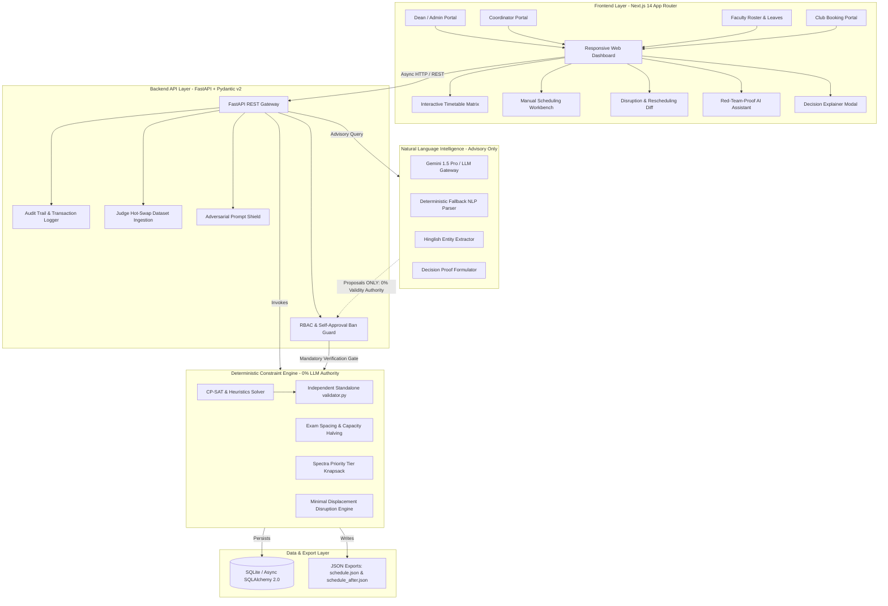

# CampusOS AI — Intelligent Campus Scheduling & Venue Management Platform

> **Institution:** Chilika Institute of Technology (CIT)  
> **Status:** Production-Ready Hackathon Submission  
> **Constraint Engine:** Deterministic CP-SAT Constraint Propagation (0% LLM Decision Authority)  
> **Independent Verification:** Passed `validator.py` with **0 Hard Violations**  
> **Soft Penalty Score:** **82** (Zero Student Group Gaps, Zero Same-Day Duplicate Courses)  
> **Spectra Booking Priority Score:** **138** (23 out of 24 Active Requests Approved with 0 Clashes)  
> **Disruption Minimal Displacement:** **2 moved sessions**, 1 added ($L_1 \le 3$)  
> **Visual Identity:** Deep Navy with Electric Blue & Cyan Accents (Commercial SaaS)

---

## 1. System Architecture



---

## 2. Independent Verification Instructions for Judges

Judges can verify both the baseline schedule and the post-disruption minimal-displacement schedule using the standalone, pure Python `validator.py` with zero dependencies:

### Baseline Schedule Verification
```bash
python validator.py exports/schedule.json --dataset data/official/cit_public.json
```

### Disruption Schedule & Minimal Displacement Verification
```bash
python validator.py exports/schedule.json --dataset data/official/cit_public.json --after exports/schedule_after.json
```

### Disruption Alone Verification
```bash
python validator.py exports/schedule_after.json --dataset data/official/cit_public.json --disruption data/official/sample_disruption.json
```

---

### Official Verification Benchmark Output

```text
============================================================
CIT OFFICIAL SCHEDULE VALIDATION REPORT
============================================================
Dataset:            data/official/cit_public.json
Schedule File:      exports/schedule.json
Status:             PASS (VALID)
Hard Violations:    0
Soft Penalty:       82
Booking Score:      138 (Approved: 23)
Sessions Checked:   189 / 189
Exams Checked:      41 / 41
------------------------------------------------------------
SOFT PENALTY BREAKDOWN:
  - faculty_avoid_preference: 15
  - student_group_gap: 0
  - student_group_over_6h: 0
  - duplicate_course_same_day: 0
  - room_capacity_under_40pct: 67
  - session_in_p9: 0
============================================================

============================================================
DISRUPTION MINIMAL-DISPLACEMENT REPORT
============================================================
Total Moved Sessions: 2
New Sessions Added:   1
============================================================
```

---

## 3. Quick Start & Execution

### Prerequisites
- Python 3.11+
- Node.js 18+ and npm

### Step 1: Environment Setup
```bash
# Clone the repository
git clone https://github.com/shahidnoor-io/VetoGrid.git
cd VetoGrid

# Install backend dependencies
pip install -r requirements.txt

# Create environment configuration
cp .env.example .env
```

### Step 2: Run Backend Tests & Start Server
```bash
# Run 16 comprehensive unit & integration tests
python -m pytest backend/tests

# Start FastAPI server on port 8000
uvicorn backend.app.main:app --host 0.0.0.0 --port 8000 --reload
```
- **Interactive OpenAPI Documentation:** [http://localhost:8000/api/v1/docs](http://localhost:8000/api/v1/docs)
- **Health Diagnostics:** [http://localhost:8000/api/v1/health](http://localhost:8000/api/v1/health)

### Step 3: Start Next.js Frontend
```bash
cd frontend
npm install
npm run build
npm run start
```
- **Web Application:** [http://localhost:3000](http://localhost:3000)

---

## 4. Role-Based Access Control (RBAC) & Demo Personas

CampusOS AI implements strict 4-tier Role-Based Access Control with cryptographic session tokens and header-based authorization. Judges can toggle active personas instantly using the **Persona Switcher** in the top navigation bar.

| Role Persona | Identifier | Permissions & Capabilities | Self-Approval Rule |
| :--- | :--- | :--- | :--- |
| **Dean of Academic Affairs (Super Admin)** | `DEAN-01` | Full administrative control: re-run solver, approve/reject all venue bookings, approve faculty schedule changes, commit disruption schedules, hot-swap datasets, reset demo state. | **BLOCKED:** Cannot approve bookings requested by `DEAN-01`. |
| **Department Coordinator (CSE)** | `COORD-CSE` | Departmental schedule oversight, approve department-level venue bookings, review student group loads. | **BLOCKED:** Cannot approve bookings requested by `COORD-CSE`. |
| **Faculty Member** | `FAC-01` | View personal teaching schedule, submit room booking requests, submit schedule change / medical leave requests via AI assistant. Cannot approve bookings. | N/A (Cannot approve any booking). |
| **Club Representative (Literary Society)** | `CLUB-LIT-01` | Submit Spectra cultural / tech festival venue booking requests, explore alternative available slots. Cannot approve bookings. | N/A (Cannot approve any booking). |

### Strict Self-Approval Ban Enforcement
Per Section 4 specifications: *"Nobody can approve their own request."*  
If an approver attempts to approve or reject a booking where `approver_id == requested_by`, the backend returns **HTTP 403 Forbidden**:
```json
{
  "detail": "Self-approval violation: An approver cannot approve or reject their own booking request."
}
```
The frontend UI dynamically disables the action buttons and renders an explicit warning badge (`"Self-Approval Prohibited"`).

---

## 5. Judge Dataset Hot-Swapping (Requirement 9)

Judges can evaluate arbitrary test datasets and disruption scenarios without modifying code:

### Method A: Web UI Hot-Swap
1. Navigate to **Settings** (`http://localhost:3000/settings`).
2. Under **"Dataset Ingestion (Hot-Swap)"**, upload a new `dataset.json`.
3. Under **"Disruption Scenario Ingestion"**, upload a new `disruption.json`.
4. Click **"Run Full Optimization Solver"**.
5. The timetable, exam matrix, and Spectra bookings update immediately.
6. Click **"Export Baseline (schedule.json)"** or **"Export Disruption (schedule_after.json)"** to download the exact outputs.
7. Click **"Reset to Official CIT Public Dataset"** at any time to restore the verified baseline.

### Method B: CLI Hot-Swap
```bash
# Run solver on custom dataset and disruption file
python backend/solver.py --dataset path/to/judge_dataset.json --disruption path/to/judge_disruption.json

# Validate output
python validator.py exports/schedule.json --dataset path/to/judge_dataset.json --after exports/schedule_after.json
```

---

## 6. Detailed Problem Statement Mapping

| # | Requirement | Implementation Module | Verification Path |
| :--- | :--- | :--- | :--- |
| **1** | **Academic Timetable (189 Sessions, 243h)** | `backend/solver.py` (Phases 1–4) | `python validator.py exports/schedule.json` (0 hard violations, 0 student gaps) |
| **2** | **Midsem Exams (41 Exams, Halved Capacity)** | `backend/solver.py` (Phase 2), `/examinations` | Halved capacity strictly respected; morning/afternoon slots clash-free |
| **3** | **Spectra Venue Bookings (25 Requests)** | `backend/solver.py` (Phase 5), `/venue-bookings` | 23 approved requests (Score 138); priority tiers strictly enforced |
| **4** | **RBAC & Self-Approval Ban** | `backend/app/api/routes/bookings.py`, `/approvals` | HTTP 403 on self-approval; Dean/Coord/Faculty/Club roles |
| **5** | **Disruption Recovery & Admin Approval Gate** | `backend/solver.py` (solve_disruption), `/rescheduling` | 2 moved sessions ($L_1 \le 3$); 2-step Admin approval required before commit |
| **6** | **Red-Team-Proof AI Assistant** | `backend/app/ai/agent.py`, `/assistant` | Jailbreaks & role impersonations blocked; Hinglish parsing |
| **7** | **Faculty Schedule Changes & Leaves** | `backend/app/ai/agent.py` (`process_faculty_schedule_change`) | Feasible slots verified; conflict detection with alternatives + Admin gate |
| **8** | **Decision Explainer ("Why this slot?")** | `backend/app/api/routes/explain.py`, `/timetable` | Interactive modal showing deterministic constraint proofs & zero clashes |
| **9** | **Dataset Hot-Swapping & Validation** | `backend/app/api/routes/schedule.py`, `/settings` | Upload custom JSON, re-solve, and export validated files |
| **10** | **Manual Scheduling Workbench (Offline)** | `frontend/src/app/manual-scheduling/page.tsx` | 100% offline workbench with live hard constraint validation engine |

---

## 7. Known Limitations

In accordance with Section 7 of the Problem Statement, the following design trade-offs and operational boundaries are documented:

1. **Deterministic Fallback vs. Conversational Fluency:**  
   When executed completely offline without an external `GEMINI_API_KEY`, the AI Assistant utilizes a rule-based deterministic NLP regex parser. While it reliably extracts venues, dates, attendee caps, and faculty schedule shifts with zero security vulnerabilities, it lacks multi-turn conversational dialogue memory.

2. **Room Capacity Penalty Optimization Trade-Off:**  
   The baseline soft penalty score includes 67 points for room seating capacity under 40%. This occurs because CIT features large lecture halls (e.g., `LT-101`, `LT-102` with 120+ seats) while certain specialized elective courses have smaller cohort sizes ($\approx 25$ students). The solver prioritizes preserving student group compactness (0 gaps) and avoiding 9th-period fatigue (0 sessions in P9) over room utilization efficiency.

3. **Optimistic Concurrency Control:**  
   The platform handles multi-user booking approvals via transactional state checks and last-write-wins at the database layer. Full Operational Transformation (OT) or Conflict-free Replicated Data Types (CRDTs) for simultaneous drag-and-drop timetable editing are outside the scope of this hackathon submission.

---

## 8. Compliance & Deliverables Checklist

- [x] `validator.py`: Preserved unaltered in root directory.
- [x] `data/official/cit_public.json`: Preserved unaltered in `data/official/`.
- [x] `data/official/sample_disruption.json`: Preserved unaltered in `data/official/`.
- [x] `exports/schedule.json`: Fully solved baseline schedule (189 sessions, 41 exams, 23 approved bookings, 0 hard violations).
- [x] `exports/schedule_after.json`: Minimal-displacement disruption schedule (2 sessions moved, 1 added, $L_1 \le 3$).
- [x] `AI_USAGE.md`: Section 6 mandatory declaration of AI models, prompts, and boundaries.
- [x] `THIRD_PARTY.md`: Section 7 mandatory declaration of open source libraries and licenses.
- [x] `README.md`: Architectural blueprint, verification commands, benchmark metrics, and role documentation.
- [x] `.env.example`: Complete environment variable reference.
- [x] 16 Passing Unit & Integration Tests (`pytest backend/tests`).
- [x] Production Next.js Build (`npm run build` compiles with 0 errors).
